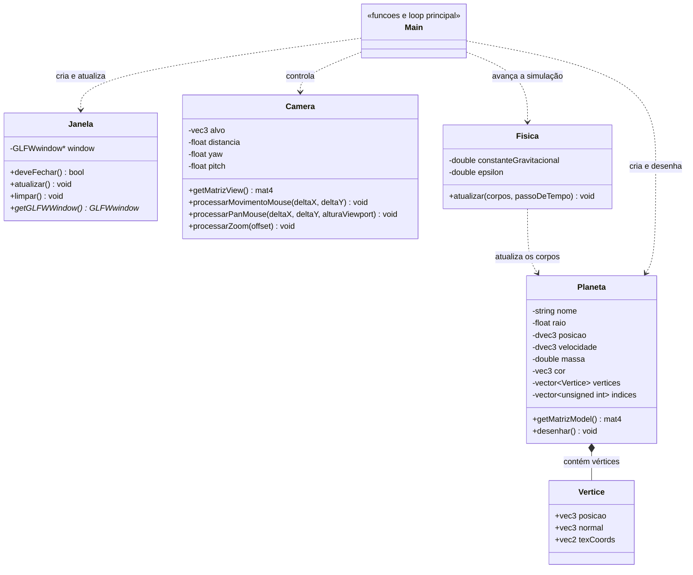

# Simulador do Sistema Solar

Aplicação em C++ que exibe uma simulação visual do Sistema Solar em 3D. O projeto combina OpenGL para renderização, GLFW para a janela e entrada do usuário, GLM para matemática 3D e uma simulação gravitacional com integração RK4.

## Como baixar e executar

### O que você precisa instalar

- **Git**, para baixar o código (ou use a opção de baixar ZIP abaixo).
- **CMake 3.20 ou superior**.
- **Python 3**, usado para instalar o gerador dos arquivos do GLAD.
- Um compilador C/C++ compatível com C++17.
- As bibliotecas de desenvolvimento do OpenGL.
- Conexão com a internet na primeira compilação: o CMake baixa GLFW e GLM automaticamente.

### Baixar o projeto

**Opção 1 — Git:** abra um terminal e execute:

```sh
git clone https://github.com/DanielMP18/Simulador-Sistema-Solar.git
cd Simulador-Sistema-Solar
```

**Opção 2 — baixar ZIP:** abra a página do projeto no GitHub, clique em **Code** → **Download ZIP**, extraia o arquivo e abra um terminal dentro da pasta extraída.

### Linux (Ubuntu/Debian)

1. Instale as ferramentas e dependências do sistema:

   ```sh
   sudo apt update
   sudo apt install build-essential cmake git python3 python3-venv python3-pip libgl1-mesa-dev xorg-dev
   ```

2. Na pasta do projeto, crie um ambiente Python, ative-o e instale o GLAD:

   ```sh
   python3 -m venv .venv
   source .venv/bin/activate
   python -m pip install glad2
   ```

3. Configure e compile o projeto:

   ```sh
   cmake -S . -B build
   cmake --build build
   ```

4. Execute:

   ```sh
   ./build/SolarSystem
   ```

### Windows (PowerShell)

1. Instale **CMake**, **Python 3** e o **Visual Studio Build Tools** com a carga de trabalho **Desenvolvimento para desktop com C++**. O Git é necessário se for usar o comando `git clone`.
2. Baixe o projeto usando uma das opções acima e abra o PowerShell na pasta do projeto.
3. Crie um ambiente Python e instale o GLAD:

   ```powershell
   py -m venv .venv
   .\.venv\Scripts\python.exe -m pip install glad2
   ```

   Não é necessário ativar o ambiente: o CMake procura o executável do GLAD dentro de `.venv\Scripts`.

4. Configure e compile:

   ```powershell
   cmake -S . -B build
   cmake --build build --config Release
   ```

5. Com o gerador padrão do Visual Studio, execute:

   ```powershell
   .\build\Release\SolarSystem.exe
   ```

Na primeira configuração, mantenha a conexão com a internet ativa para que o CMake baixe GLFW e GLM. Se o comando `cmake` não for encontrado, confira se o CMake foi instalado e adicionado ao PATH.

## Controles

- Arraste com o **botão esquerdo** para orbitar a câmera.
- Arraste com o **botão direito** para deslocar o enquadramento.
- Use a **roda do mouse** para aproximar ou afastar.

## Estrutura do projeto

- `src/main.cpp`: inicializa a aplicação, define os shaders e coordena a simulação e o desenho de cada quadro.
- `include/Planeta.hpp` e `src/Planeta.cpp`: representam os planetas, geram a malha esférica e configuram os buffers de geometria.
- `include/Fisica.hpp` e `src/Fisica.cpp`: calculam a gravidade e atualizam posição e velocidade dos corpos com o método RK4.
- `include/Camera.hpp` e `src/Camera.cpp`: controlam a câmera e calculam sua matriz de visão.
- `include/Janela.hpp` e `src/Janela.cpp`: encapsulam a janela GLFW e as operações básicas do ciclo da aplicação.

## Diagrama de classes



`Main` representa o fluxo do programa em `src/main.cpp`, não uma classe C++: o ponto de entrada e o loop principal ficam em funções. Os shaders também são definidos nesse arquivo, dentro de uma função, e não são classes do diagrama.

## Conceitos de computação gráfica

- **Vertex data:** cada vértice contém posição, normal e coordenadas de textura.
- **VBO (Vertex Buffer Object):** armazena os dados dos vértices na GPU.
- **EBO (Element Buffer Object):** armazena índices que permitem reutilizar vértices na formação dos triângulos.
- **VAO (Vertex Array Object):** registra como os dados dos buffers são interpretados.
- **Shaders:** o vertex shader transforma vértices; o fragment shader calcula a cor e a iluminação.
- **Transformações Model, View e Projection:** Model posiciona e escala o planeta; View representa a câmera; Projection aplica a perspectiva.
- **GLM:** fornece vetores e matrizes usados nesses cálculos.

## Simulação física

A gravitação newtoniana é integrada por RK4 sobre o estado completo (posição e velocidade de todos os corpos). Cada estágio calcula as acelerações usando simultaneamente as posições daquele estágio, incluindo todos os pares de corpos e o parâmetro de suavização `epsilon`.

O estado físico usa vetores e massas em precisão dupla. O exemplo usa unidades normalizadas, com `G = 1e-4` e `epsilon = 1e-3`; ambos podem ser ajustados no construtor de `Fisica`. A animação avança o tempo simulado 100 vezes mais rápido que o relógio, usando subpassos RK4 de no máximo `0,05 s` para manter a precisão.

Os planetas começam com velocidades tangenciais calculadas para órbitas circulares aproximadas em torno do Sol. O recuo do Sol é incluído para que o momento linear inicial total seja zero. As massas planetárias usam a mesma escala relativa à massa solar; as distâncias continuam comprimidas para a visualização, portanto as órbitas são uma aproximação e não uma efeméride real.

## Visualização

Cada planeta deixa uma trilha colorida limitada aos seus 2.400 últimos pontos, facilitando acompanhar o sentido e o percurso do movimento.


